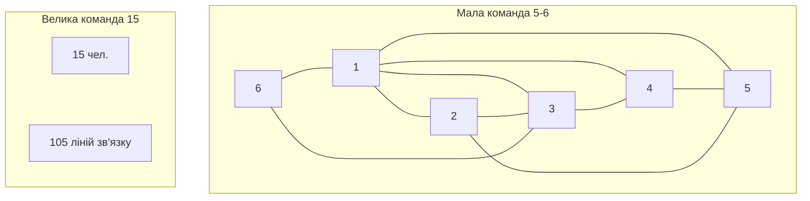
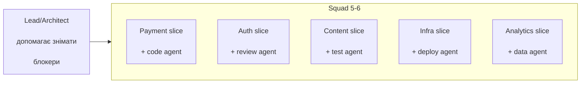
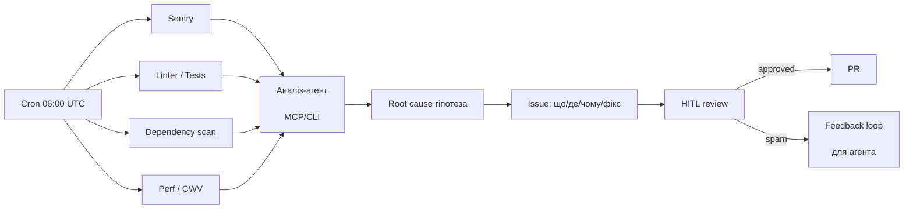
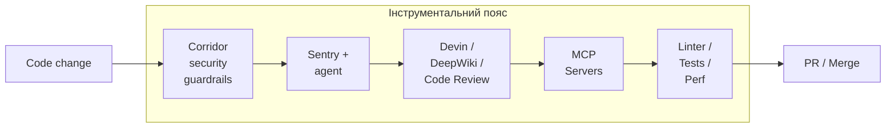
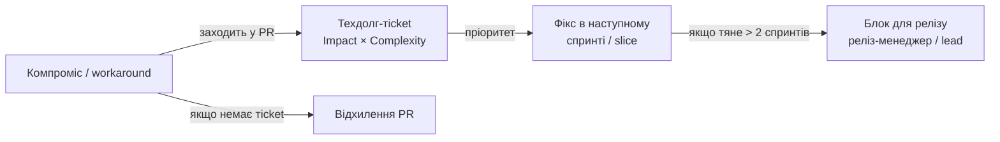
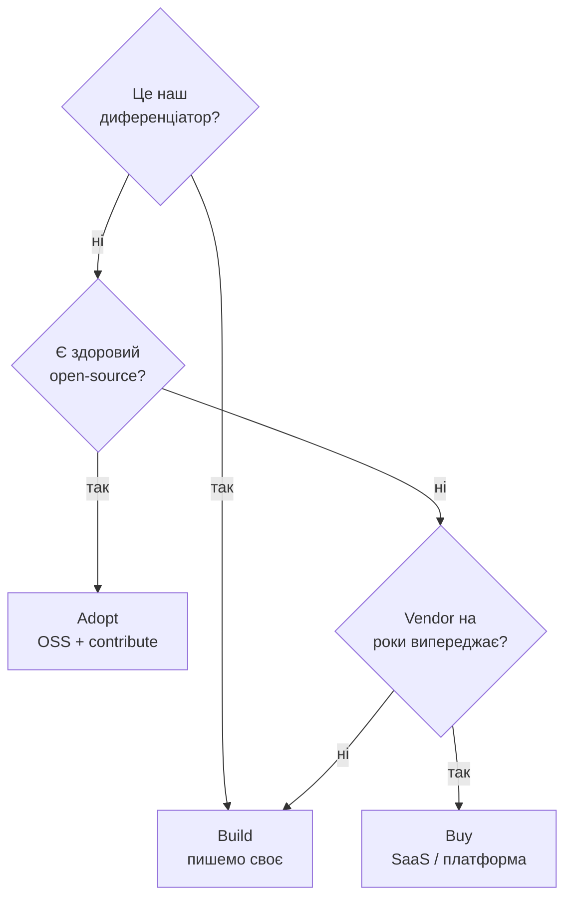
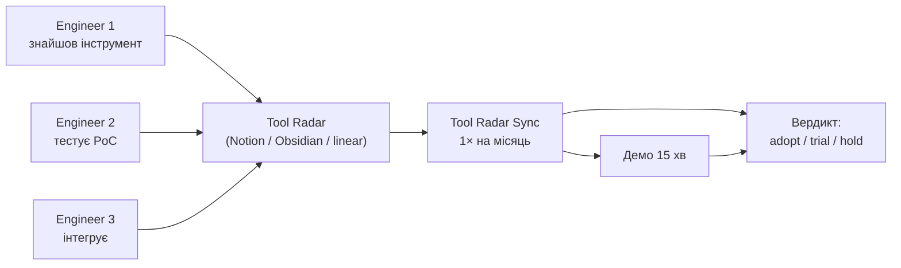

# Додаток: слайди про командний процес, моніторинг, техдолг та інфраструктуру

> Додаткові 7 слайдів українською, що розширюють основну презентацію.  
> Вставляються в основний слайд-дек `interviews/ai-team-of-one-presentation.md` між існуючими слайдами.

---

## Куди вставити

| Новий слайд | Назва | Куди вставити | Логіка вставки |
|---|---|---|---|
| 5.5 | Маленькі команди 5–6 vs 10–20 | Після слайду 5 «Розподіл ролей і ресурсів» | Визначили ролі — тепер говоримо, скільки людей має бути в одній бойовій одиниці. |
| 5.6 | Делегування + slice-власність | Після слайду 5.5 | Визначили розмір — тепер механіка роботи: кожен володіє slice. |
| 6.5 | Щоденне сканування: MCP/CLI-агенти заводять задачі | Після слайду 6 «Асинхронна комунікація» | Async-культура потребує автоматичного триажу блокерів/багів. |
| 6.6 | Інструментальний пояс: чим обвішуємося | Після слайду 6.5 | Сканування потребує інструментів; показуємо стек. |
| 7.5 | Нульова толерантність до техдолгу | Після слайду 7 «Код — вже не дитя» | Код ітеративний, але тимчасові рішення не повинні затримуватися. |
| 9.5 | Buy / Build / Adopt: не винаходимо велосипед | Після слайду 9 «Контекстний менеджмент» | Контекст організований — тепер рішення про інфру: брати готове, якщо можна. |
| 9.6 | Open Source Tool Radar: команда ділиться знахідками | Після слайду 9.5 | Buy/build — частина підходу, інша — постійний пошук і обмін open-source інструментами. |

**Примітка:** якщо роль — CTO/VP/Head of Engineering, слайди 5.5–5.6 мають бути сильніше. Якщо роль — Principal/Staff/Founding Engineer, акцент переносимо на 6.5–7.5 (інструменти, моніторинг, техдолг).

---

### Слайд 5.5. Маленькі команди 5–6 vs 10–20

**Теза:** 5–6 активних людей дають більше продуктивності, ніж 10–20 у «команді-варезі». Чим більше людей, тим більше комунікаційних ребер — а отже, менше фокусу та більше узгоджень.

**Текст на слайді:**
- Best-in-class проєкти використовували команди >4 рази менші, ніж найгірші (QSM)
- 9+ людей — продуктивність падає (ISBSG)
- 5–6 чоловік — 15 ліній комунікації
- 15 людей — 105 ліній комунікації
- Розбивати на autonomous squads по 5–6

**Візуал (Mermaid):**



**Нотатка спікеру:**  
Не кажіть «людей багато — погано». Кажіть: «Брукс пояснив, що додавання людей до запізнюваного проєкту робить його ще більш запізнілим. Чому? Бо кожна людина множить кількість зв’язків, і ці зв’язки коштують. 5–6 чоловік — це не магічне число, а точка, де командний рівень довіри ще високий, а комунікаційний борг ще малий».

**Пруф:**
- QSM, 2005: великі команди (>20) ледь випереджали маленькі (<5) по часу, але коштували набагато більше. Best-in-class були >4x меншими.  
  [https://www.qsm.com/blog/2012/top-performing-projects-use-small-teams]
- ISBSG / Rodriguez et al.: команди 9+ суттєво менш продуктивні; оптимум 3–5, близький діапазон 5–7; після 9–11 продуктивність падає.  
  [https://drg.web.uah.es/jif/RodriguezEtAl_JSS12.pdf]
- Brooks’ Law: додавання людей у запізнений проєкт робить його пізнішим через комунікаційний оверхед.

---

### Слайд 5.6. Делегування + slice-власність

**Теза:** Не «хто вільний — візьме». Кожен член команди — власник slice: він відповідає за фічу від SDD до продакшену, включно з агентом, тестами та документацією.

**Текст на слайді:**
- Squad 5–6 осіб
- Кожен володіє вертикальним slice
- Поруч — агент-помічник, який робить 70% рутини
- Рішення приймає людина, агент виконує
- Active participation: не можна «сидіти на фічі», slice має овнера

**Візуал (Mermaid):**



**Нотатка спікеру:**  
«You build it, you run it» — старий амазонівський принцип. Зараз він доповнюється: «You own the slice, the agent works for you». Людина не знімає з себе відповідальність, а делегує агенту виконання. Якщо людина пасивна — slice помирає. Тому slice-власність = active participation.

**Пруф:**
- Content Agent Platform: 8 агент-ролей, але кожна роль має власний prompt і HITL-гейт — людина визначає, де агент може рухатися далі.
- My Zodiac AI: 16 bounded contexts — кожен context це свій slice з чіткою відповідальністю.

---

### Слайд 6.5. Щоденне сканування: MCP/CLI-агенти заводять задачі

**Теза:** Замість того, щоб людина вранці відкривала Sentry, Linear, GitHub і шукала, що горить, — система сама сканує джерела, аналізує код і заводить задачу з припущенням root cause, метрикою та запропонованим фіксом.

**Текст на слайді:**
- Щодня: Sentry, CI, dependency scanners, lint, perf, security
- Агент через MCP/CLI читає код, шукає причину
- Створює Linear/Jira issue: що, де, чому, як фіксити
- Людина перевіряє, ставить пріоритет, мерджить
- Система навчається: false positives → feedback loop

**Візуал (Mermaid):**



**Нотатка спікеру:**  
Наведіть конкретні інструменти: Devin має темплейт «Daily Sentry Error Fixes», що кожен ранок забирає топ unresolved Sentry issues, робить root-cause, тест, PR. Cursor Autonomous Agent інтегрується з Sentry і може коментувати чи одразу пропонувати фікс. Tembo з MCP Sentry + GitHub відкриває PR. Continue Mission Control аналізує продакшен-ерори й створює PR. Це не мрія — це вже існуючі темплейти.

**Пруф:**
- Devin Docs: Daily Sentry Error Fixes — щоденний Devin-сесія, Sentry MCP, top-5 unresolved errors, root cause, PR з regression test.  
  [https://docs.devin.ai/automation-templates/daily-sentry-error-fixes]
- Cursor workflows — Investigate Sentry Issues: watch → investigate → report / fix PR, групує дублікати, корелює зі змінами коду.  
  [https://cursor.com/workflows/autonomous-agents/investigate-sentry-issues]
- Continue Mission Control Sentry integration: агент читає stack trace, дивиться зміни, відкриває PR.  
  [https://docs.continue.dev/mission-control/integrations/sentry]
- Tembo: Sentry webhook → агент аналізує контекст, пише фікс у sandbox, відкриває PR.  
  [https://docs.tembo.io/learn/fix-production-bugs]

---

### Слайд 6.6. Інструментальний пояс: чим обвішуємося

**Теза:** Команда — це не «одна IDE». Це набір агентів, MCP-серверів, сканерів і гейтів, що обважнюють кожен PR, деплой та продакшен. Інструменти не навʼязують єдиний метод — вони створюють спільний якісний бар’єр.

**Текст на слайді:**
- **Corridor** — security guardrails для AI-агентів, PR-скан, MCP/CLI
- **Sentry + agent** — продакшен-ерори → PR
- **Devin / DeepWiki / Code Review** — deep codebase research, review-агент
- **MCP** — єдиний інтерфейс до Sentry, GitHub, Linear, Jira
- **CLI** — локальні хуки, що бʼють перед коммітом
- **Linter + tests + perf** — автоматичні гейти

**Візуал (Mermaid):**



**Нотатка спікеру:**  
Ключова ідея: інструменти не замінюють один одного, а створюють шари. Corridor не дає агенту написати небезпечний код. Sentry бачить продакшен-поведінку. Devin/DeepWiki дають deep research. MCP дає агентам доступ до всіх систем без кастомних інтеграцій. Linter/tests — останній автоматичний гейт. Кожен інструмент вибирається під конкретний slice, але загальний стандарт: жоден PR не йде без автоматичних перевірок.

**Пруф:**
- Corridor: AI code security platform, guardrails for Cursor/Claude Code/Devin/Codex/Copilot, pre-commit scanning, PR security reviews.  
  [https://corridor.dev/]
- Corridor docs: інтеграція з Claude Code, Codex, Cursor, Devin через MCP/CLI.  
  [https://docs.corridor.dev/]

---

### Слайд 7.5. Нульова толерантність до техдолгу

**Теза:** Техдолг — це не «список на майбутнє». Це приховані помилки та костилі, які множаться. Тимчасове рішення не йде в продакшен без чіткого плану заміни.

**Текст на слайді:**
- Тимчасове рішення ≠ борг; борг — це коли тимчасове стає постійним
- Кожен PR, що вводить compromise, має заводити техдолг-тicket з Impact × Complexity
- Ротація техдолгу: 1 інженер на squad/тиждень
- Автоматичне сканування знаходить костилі й заводить задачі
- Метрика: тренд відкритого техдолгу ↓

**Візуал (Mermaid):**



**Нотатка спікеру:**  
Це сильна позиція: «Я не проти хаків під час вайбу, але в продакшен вони не йдуть. Якщо ми свідомо робимо компроміс, ми одразу заводимо техдолг-тикет, оцінюємо Impact × Complexity і плануємо заміну. Якщо за 2 спринти не замінили — це стає release blocker, доки не пояснимо, чому ми це тягнемо». Це звучить жорстко, але інвестори й CTO люблять передбачувану якість.

**Пруф:**
- Zalando: техдолг backlog 70+ тікетів, запровадили rotation — один інженер на тиждень, 8 тижнів — зменшення боргу, після 6 місяців стабільне зменшення.  
  [https://engineering.zalando.com/posts/2021/11/technical-debt.html]
- Shopify 25% Rule: виділяти 25% часу на техдолг; категорії Daily / Monthly / Yearly debt; «if you do not pay it down, you get more technical debt on top for free».  
  [https://shopify.engineering/technical-debt-25-percent-rule]

---

### Слайд 9.5. Buy / Build / Adopt: не винаходимо велосипед

**Теза:** Якщо ринок вже дає готове рішення, писати свій сирий продукт — це не економія, а відкладання болю. Buy, коли це не диференціатор; adopt open-source, коли є здорова спільнота; build тільки, коли без варіантів.

**Текст на слайді:**
- **Buy** — vendor випереджає нас на роки, проблема не є диференціатором
- **Adopt open-source** — здорова комʼюніті, credible backers, open standards
- **Build** — compliance, security, scale, або немає альтернативи
- Виділяти «тимчасову інфру»: не глибоко вбудовуватися туди, де скоро зʼявиться готове рішення

**Візуал (Mermaid):**



**Нотатка спікеру:**  
Приклад: не пиши свій auth, свій feature-flag, свій search, свій payment reconciliation, якщо є Sentry, Corridor, Devin, PostHog, LaunchDarkly, Stripe. Якщо рішення за рік стане commodity — бери готове. «Якщо ми беремо Corridor, Sentry agent чи Devin для code review, ми отримуємо продукт, який конкуренти будуть вдосконалювати за свій рахунок, а ми — підключати оновлення».

**Пруф:**
- Rootly KubeCon panel (Saxo, LEGO, Chainalysis, Wolt): buy, коли vendor на роки впереді; adopt OSS, коли здорова спільнота; build тільки за compliance/security/scale; platform = product, operational work починається після запуску.  
  [https://rootly.com/blog/buy-build-or-adopt-seasoned-platform-engineers-weigh-in]
- Thoughtworks Build vs Buy: open standards, community, optionality, security offload — ключові критерії.  
  [https://www.thoughtworks.com/content/dam/thoughtworks/documents/e-book/tw_ebook_build_vs_buy_2022.pdf]

---

### Слайд 9.6. Open Source Tool Radar: команда ділиться знахідками

**Теза:** Open-source — це R&D ринку. Кожен інженер, що знайшов і протестував корисний інструмент, має поділитися: що, навіщо, як встановити, як інтегрувати, обмеження. Не навʼязуємо єдиний стек — створюємо спільний радар здорових інструментів.

**Текст на слайді:**
- Кожен інженер — R&D сенсор
- Щомісячний «Tool Radar Sync» 15–30 хв
- Формат: інструмент / проблема / 15-хв демо / рішення / обмеження
- Не вимоги, а рекомендації
- Open-source, який вирішує 80% — не пишемо своє

**Візуал (Mermaid):**



**Нотатка спікеру:**  
«Ми не навʼязуємо однаковий IDE чи однакову AI-модель, але ми домовляємося, що якщо хтось знайшов інструмент, який вирішує болючу проблему — він ділиться. Це економить N× годин всім іншим. Формат легкий: 15 хв демо, 5 хв Q&A, рішення adopt / trial / hold. Так команда стає швидшою, ніж будь-який vendor».

**Пруф:**
- Content Agent Platform: MCP servers, OpenRouter free LLM rotation, Qdrant, MarkItDown — всі open-source інструменти, обрані після PoC.
- Open Design: 26 coding agent CLIs, BYOK proxy, HyperFrames, skills filesystem — open-source екосистема, що розвивається.

---

## Оновлена структура основного слайд-дека (повна)

```
Слайд 0.  Титул
Слайд 1.  Не навички — операційна модель
Слайд 2.  Швидкість: 1–2 тижні від ідеї до продакшену
Слайд 3.  Team of One = оркестрація
Слайд 4.  Агент — конфігурація бізнесу
Слайд 5.  Розподіл ролей і ресурсів
Слайд 5.5 Маленькі команди 5–6 vs 10–20
Слайд 5.6 Делегування + slice-власність
Слайд 6.  Асинхронна комунікація
Слайд 6.5 Щоденне сканування: MCP/CLI-агенти заводять задачі
Слайд 6.6 Інструментальний пояс
Слайд 7.  Код — вже не дитя
Слайд 7.5 Нульова толерантність до техдолгу
Слайд 8.  Документація як symlinks
Слайд 9.  Контекстний менеджмент
Слайд 9.5 Buy / Build / Adopt
Слайд 9.6 Open Source Tool Radar
Слайд 10. Бізнес-проблема → метрика → інфраструктура
Слайд 11. Нова ієрархія навичок
Слайд 12. Висновок
```

---

## Рекомендації за роллю

- **CTO / VP / Head of Engineering**: слайди 5.5, 5.6, 9.5, 9.6 — ключові. Доповніть нотатками про вартість великих команд і ротацію техдолгу.
- **Product Lead / Founder**: слайд 9.5 — must. Поясніть, як buy/build економить runway.
- **Principal / Staff / Founding Engineer**: слайди 6.5, 6.6, 7.5 — найважливіші. Покажіть конкретні MCP, Sentry-агентів і план заміни техдолгу.
