# Team of One: AI як операційна система

> Презентація для технічного співбесіди. Весь контент — українською.  
> Мета: показати не сухий список навичок, а нову модель роботи з продуктом, комунікацією та агентами.

---

## 30-секундний пітч (для початку розмови)

> «Моє головне вміння за останні 8 місяців — будувати продукти швидше за команду.  
> AI для мене — не автокомпліт, а операційна система: Team of One, де один інженер оркеструє агентів, документацію та інфру.  
> Я зробив 8+ продуктів за 8 місяців, серед них — SaaS з 1500 платними користувачами за 4 місяці, мультимовний блог на 66 мовах і агентську платформу з 1700 тестами.  
> Головне, що я зрозумів: агент не може бути універсальним продуктом. Він працює тільки як налаштування під конкретний бізнес-процес.»

---

## 10 тезісів

1. **AI перетворює не швидкість набору коду, а всю операційну модель продуктової команди.**  
   Була: PM → дизайн → інженери → QA → devops. Стає: один інженер-диригент, який ставить процес, а агенти виконують ролі.

2. **MVP від ідеї до продакшену з повною інфрою — це 1–2 тижні, якщо процес вибудуваний.**  
   Швидкість можлива не тому, що модель «генерує класно», а тому, що за нею стоїть TDD, SDD, CI/CD, моніторинг і HITL-гейти.

3. **«Team of One» — це не соло-забив, а оркестрація спеціалізованих агентів.**  
   Різні агенти відповідають за різні ролі: RAG, code-review, QA, генерацію контенту, локалізацію, інфру. Людина тримає процес, рішення та якість.

4. **Агент — це не окрема сутність і не універсальний продукт. Він — конфігурація під бізнес-процес.**  
   Не повторювати помилок OpenAI/Anthropic, які будували універсальні «агенти на всі випадки». Починати з бізнесу, а потім ліпити агента поруч.

5. **Розподіляй процеси та ресурси: визначай зону найбільшої експертизи та заглиблюй її.**  
   Комбінація людини + специфічного агента в конкретному руслі дає результат, а «універсальний інженер + універсальний агент» дає розпилення.

6. **Щоденні годинні мітинги втратили сенс. Асинхронна комунікація + дообстеження — двигун швидкості.**  
   Блокери вирішуються до зустрічі. Якщо питання — ресерч із AI і приходь із 2–3 рішеннями. Зустріч залишається для рішень, а не для оновлення статусів.

7. **Код — вже не «дитя». Його вартість падає, його читатиме машина. Цінність переходить у процес.**  
   Кілька ітерацій дизайн → код → тести → рефакторинг вирішують більшість проблем. Людині достатньо розуміти верхньорівнево, а деталями керує LLM + тести + ревʼю-агент.

8. **Документація та діаграми — це не краса, а machine-readable symlinks.**  
   В неї легко читається машині, а людина тримає карту. SDD + TDD, залежно від масштабу, стають єдиною мовою команди та агентів.

9. **Контекстний менеджмент — найважливіший навик: не годувати машину тоннами, а вказати, де що шукати.**  
   Контекст — нове обмеження. Грамотна документація з інструментами та межами замінює тисячі рядків прикладів у промпті.

10. **Бізнес-проблема йде першою, інфраструктура — другою.**  
    Технічні навички йдуть на третій план: добре вибудований процес закриває більшість технічних нюансів, а LLM закриває решту.

---

## Слайд-дек: 12 кадрів

---

### Слайд 0. Титул

**Заголовок:** Team of One: AI як операційна система

**Підзаголовок:** Як за 8 місяців побудувати 8+ продуктів, не ганяючись за «якістю коду» — ганяючись за процесом

**Візуал (Mermaid):**

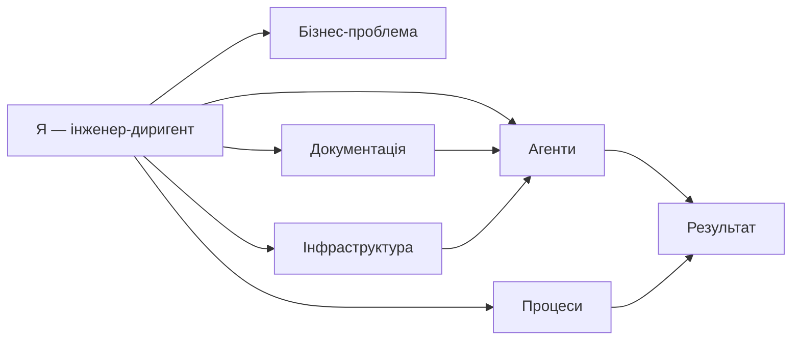

**Коментар до дизайну:** Центр — людина, але всі стрілечки йдуть від неї до інших сутностей. AI — не окремий месія, а інструмент у руках людини, що тримає стратегію.

---

### Слайд 1. Не навички — операційна модель

**Теза:** AI змінив не те, як ми пишемо if-else, а те, як улаштована команда.

**Текст на слайді:**
- була модель: PM → дизайн → 3 інженери → QA → DevOps
- нова модель: один інженер + агенти на кожну роль + HITL-гейти
- ключ: не більше моделей, а правильне розміщення людського судження

**Візуал (Mermaid):**

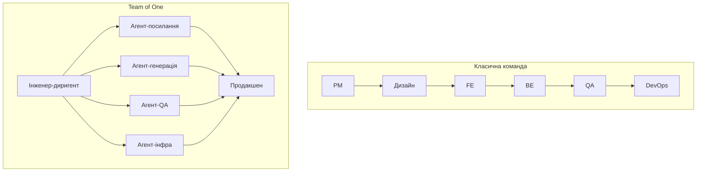

**Нотатка спікеру:**  
Не кажіть «я швидко пишу код». Кажіть «я перебудував команду так, що одна людина закриває цикл від ідеї до продакшену, тому що агенти беруть на себе рутинні ролі, а я тримаю судження, архітектуру та прийняття рішень».

**Пруф:**
- 8 продуктів за 8 місяців: content-agent-platform, qa-agent, social-poster-agent, pitchmatch, my_zodiac_ai, astro-ai-landing, devinpipe, mzai-plugins.
- Відкритий випадок: PaellaDoc «A factory of one» — solo-founder із агентами працює як команда, але головним обмеженням стає увага, а не швидкість набору.  
  [https://paelladoc.com/blog/factory-of-one/]

---

### Слайд 2. Швидкість: 1–2 тижні від ідеї до продакшену

**Теза:** MVP у продакшені — це не демо, а реальна інфраструктура, тести, моніторинг та документація.

**Текст на слайді:**
- Day 1–2: скелет стеку, CI/CD, базовий домен
- Day 3–5: перший робочий slice з тестами
- Day 6–10: SDD-діаграми, ADR, HITL, моніторинг
- Day 11–14: продакшен + метрики

**Візуал (Mermaid):**

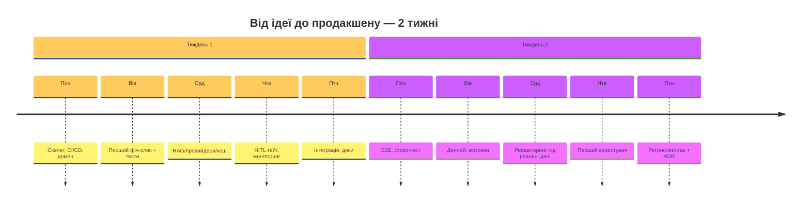

**Нотатка спікеру:**  
Ключове слово — «slice», а не «повний продукт». За 1–2 тижні можна випустити production-ready горизонтальний slice, який містить реальну інфру, а не тільки UI-заглушки. Повний обсяг потім нарощується по вертикалі.

**Пруф:**
- First Mate Technologies: QueueMate — реальний production-додаток (auth, real-time, SMS, a11y) за дні, а не місяці.  
  [https://www.firstmate.tech/resources/build-mvp-in-days-with-ai-queuemate-case-study]
- Agent.ceo: платформа з 7 агентами на GKE/NATS/Firestore — від 0 до продакшену за 1 тиждень.  
  [https://agent.ceo/blog/zero-to-production-one-week]
- Мій власний: Pitchmatch — маркетплейс подій із Stripe Connect, PostGIS, BullMQ, Ionic PWA — весь стек піднятий за короткий термін.

---

### Слайд 3. Team of One = оркестрація, не соло

**Теза:** Один інженер не замінює команду «роблячи все руками». Він стає диригентом, який делегує ролі агентам.

**Текст на слайді:**
- Content Agent Platform: 8 ролей-агентів
- QA Agent: detect → judge → PR-пропозиція
- MZAI Plugins: 27 плагінів, 50+ навичок, 19 sub-агентів
- devinpipe: оптимізація токенів Devin за рахунок PNG-конверсії

**Візуал (Mermaid):**

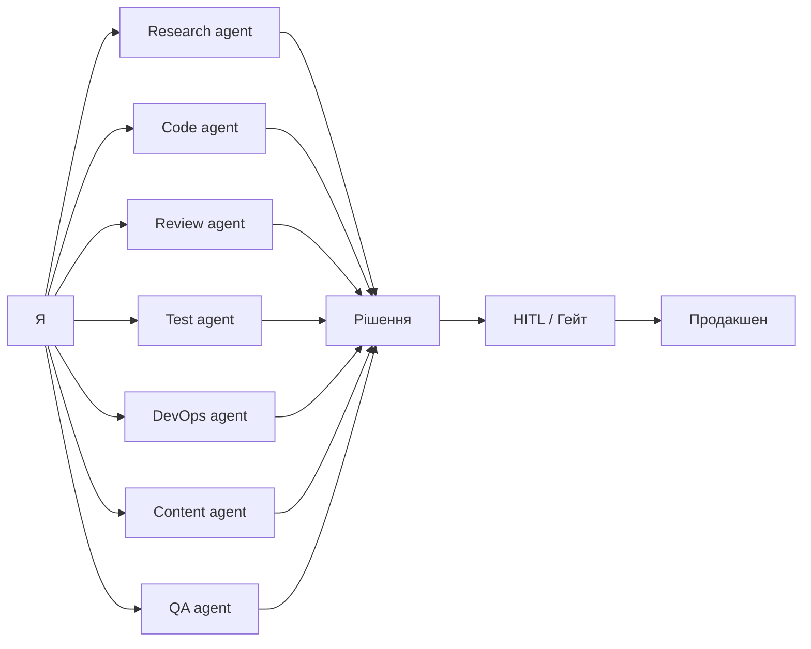

**Нотатка спікеру:**  
Називайте конкретні агенти, які вже є у ваших репозиторіях: сканер, парсер, SEO-локалізатор, glossary, QA-critic, refiner, validator (content-agent-platform); review-агент, code-агент, test-агент. Це показує, що ви не маркуєте, а реально будували.

**Пруф:**
- Content Agent Platform: ~35k LOC Python, ~1700 тестів, 8 агент-ролей, hexagonal ports, 18 ADR.
- QA Agent: 358 Python-тестів, 67 Vitest-кейсів, LangGraph-brain, Playwright/Schemathesis sidecar.
- MZAI Plugins: 27 плагінів, 50+ навичок для Claude Code/Cowork.

---

### Слайд 4. Агент — конфігурація бізнесу, не універсальний продукт

**Теза:** Найбільша помилка С-левелів OpenAI/Anthropic — лізти з універсальним агентом. Працює тільки «бізнес-процес → агент під нього».

**Текст на слайді:**
- ❌ Універсальний агент = розпилена якість + невирішувана складність
- ✅ Бізнес-процес → чіткі межі → агент-обгортка → HITL
- Приклади: WISMO-бот, Return Agent, Voice-of-Customer, Inventory Agent

**Візуал (Mermaid):**

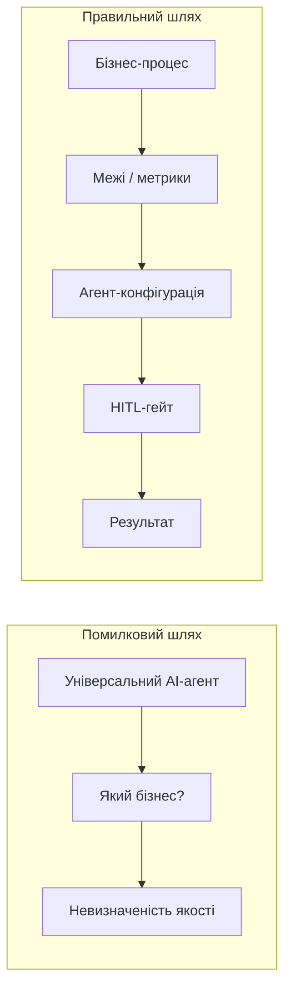

**Нотатка спікеру:**  
Можна піти трохи в полеміку: «OpenAI COO Бред Лайткап відкрито казав, що AI ще не проник у бізнес-процеси підприємств. Чому? Тому що вони будували універсальні моделі, а не конфігурації під конкретні операції. Мій досвід підтверджує: кожен агент, який працює, виріс поруч із бізнес-завданням».

**Пруф:**
- WorkOS / Anthropic & OpenAI Enterprise Agent Playbook: найуспішніші впровадження починали з простих composable патернів, а не складних multi-agent архітектур.  
  [https://workos.com/blog/enterprise-ai-agent-playbook-what-anthropic-and-openai-reveal-about-building-production-ready-systems]
- MongoDB «The Case Against Building Your Own Agent Platform»: workflow system з LLM у петлі ≠ агент; перехід вимагає памʼяті, eval, governance, оркестрації.  
  [https://www.mongodb.com/company/blog/technical/case-against-building-your-own-agent-platform]
- OpenAI COO: AI ще не проник у enterprise business processes.  
  [https://techcrunch.com/2026/02/24/openai-coo-says-we-have-not-yet-really-seen-ai-penetrate-enterprise-business-processes/]
- Мій RoBeauty playbook: кожен агент привʼязаний до конкретного процесу (WISMO, returns, inventory, localization).

---

### Слайд 5. Розподіл ролей і ресурсів

**Теза:** Не робити всіх «фулстек-універсалів». Визначити зону найбільшої експертизи і поглибити — саме так працюють і люди, і агенти.

**Текст на слайді:**
- Людина: бізнес-розуміння, архітектура, прийняття рішень
- Агент 1: генерація коду під конкретний bounded context
- Агент 2: генерація/локалізація контенту
- Агент 3: code review / QA
- Агент 4: devops / інфра

**Візуал (Mermaid):**

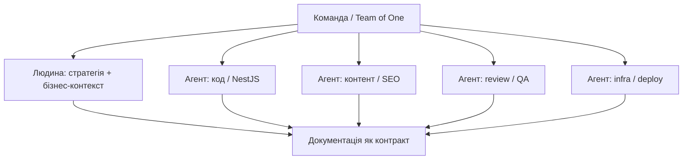

**Нотатка спікеру:**  
Поясніть: в My Zodiac AI backend — 16 bounded contexts, кожен із власною відповідальністю. У Content Agent Platform — 8 ролей-агентів. Спеціалізація дозволяє не множити складність, а множити пропускну здатність.

**Пруф:**
- My Zodiac AI: 16 bounded contexts (core, astrology, ai, business, payments, companion, cosmic-weather, daily-vibe, wellness, engagement, notifications-v2, fault-tolerance, profile, admin, shared, infrastructure).
- Content Agent Platform: 8 ролей, hexagonal ports, кожен агент відповідає за один крок пайплайну.

---

### Слайд 6. Асинхронна комунікація → зустрічі для рішень, не для статусів

**Теза:** Щоденні годинні мітинги — пережиток. Блокери вирішуються до зустрічі через AI-дослідження та письмові оновлення.

**Текст на слайді:**
- старе: 5 × 30–60 хв мітингів на тиждень
- нове: письмові stand-up-оновлення + AI-дослідження + рішення на зустрічі
- правило: «якщо питання — приходь із 2–3 варіантами відповіді»

**Візуал (Mermaid):**

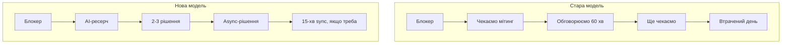

**Нотатка спікеру:**  
Наведіть дослідження: команда втрачає в середньому 4,2 години на тиждень через погано скоординовані мітинги, а відновлення фокусу після переривання займає 23 хвилини. Це не «мені не подобаються мітинги», це економіка уваги.

**Пруф:**
- AskAntech «Async Communication for Engineering Teams»: async-first дає довші блоки глибокої роботи, кращу документацію та кращий код.  
  [https://www.askantech.com/async-communication-engineering-teams-fewer-meetings-better-code/]
- Fullscale: 78% розробників вважають «meeting overload» головною продуктивністю-перешкодою; Linear 2025 — 4,2 год/тиждень втрачається на мітинги.  
  [https://fullscale.io/blog/guide-to-async-daily-standups/]

---

### Слайд 7. Код — вже не дитя. Процес + тести = новий стандарт якості

**Теза:** Не привʼязуватися до коду. Його вартість упала, машина все одно читатиме основний обсяг. Цінність — у швидкій ітерації, тестах і документації.

**Текст на слайді:**
- 1–2 дизайн-ітерації
- 3–5 код-ітерацій
- автоматичні тести + review-агент
- людина: архітектура, межі, метрики

**Візуал (Mermaid):**

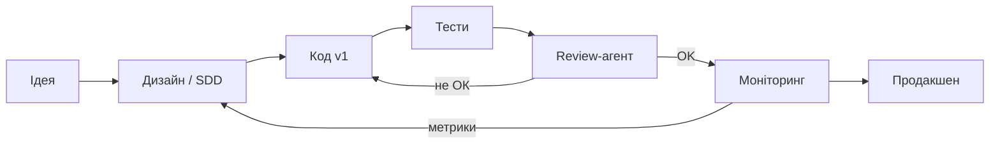

**Нотатка спікеру:**  
Візьміть цифри: bundle Soulwise AI 250 → 160 KB (-36%), LCP -1,2 с, conversion +8%. Це сталося не тому, що я «захистив код як дитя», а тому, що я робив ітерації з метриками. Перша версія завжди тимчасова; метрики вирішують, залишати чи переробляти.

**Пруф:**
- First Mate: 508 автоматичних тестів на MVP, TDD-цикл red → green → review → verify. Без цього AI-генерація — просто швидкий ризик.  
  [https://www.firstmate.tech/resources/build-mvp-in-days-with-ai-queuemate-case-study]
- PaellaDoc: «Unreviewed output is not progress, it is risk with a nice commit message».  
  [https://paelladoc.com/blog/factory-of-one/]
- Мій: Soulwise AI bundle -36%, LCP -1,2 с, conversion +8%; AI code-review зняв ~30% навантаження з команди.

---

### Слайд 8. Документація як symlinks для машини

**Теза:** Кожен проєкт має містити діаграми та документацію. Людина читає повільно, машина — швидко. Документ — це не PDF, а навігаційна карта для агента.

**Текст на слайді:**
- SDD + TDD — базовий стандарт
- ADR — рішення, а не тільки код
- Mermaid-діаграми — machine-readable
- README, STATUS, RUNBOOK — живі документи

**Візуал (Mermaid):**

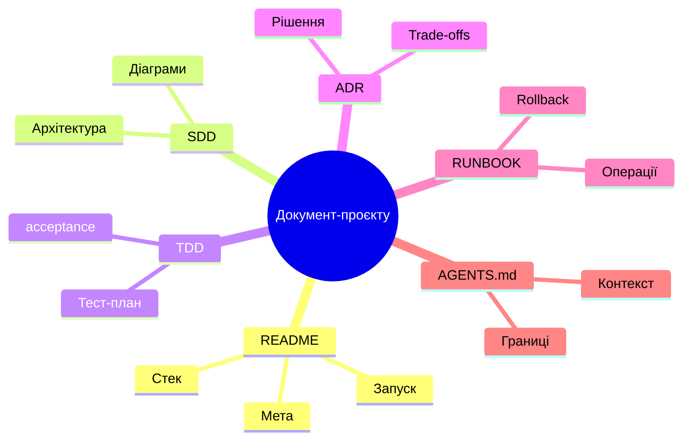

**Нотатка спікеру:**  
У Content Agent Platform — 18 ADR, STATUS.md на 600+ рядків, hexagonal ports з чіткими контрактами. У My Zodiac AI — CLAUDE.md, AGENTS.md, CHANGELOG. Це не краса: коли я відкриваю старий репозиторій через місяць, агенти й я розуміємо, що де шукати, не перечитуючи код.

**Пруф:**
- Content Agent Platform: 18 ADR, STATUS.md, RUNBOOK.md, MEGAPLAN-COST-FORECAST, ~1700 тестів.
- My Zodiac AI: AGENTS.md, CLAUDE.md, CHANGELOG, docs/ з 20+ файлами.

---

### Слайд 9. Контекстний менеджмент: не годувати, а вказувати

**Теза:** Головне обмеження — не швидкість моделі, а контекст. Не треба пхати машині тонни. Треба давати symlinks: які інструменти є і де їх шукати.

**Текст на слайді:**
- Контекст = новий CPU
- Не давати 10k рядків коду у промпт
- Давати: task brief + links to docs + tool list + test command
- Машина сама підтягне, що потрібно

**Візуал (Mermaid):**

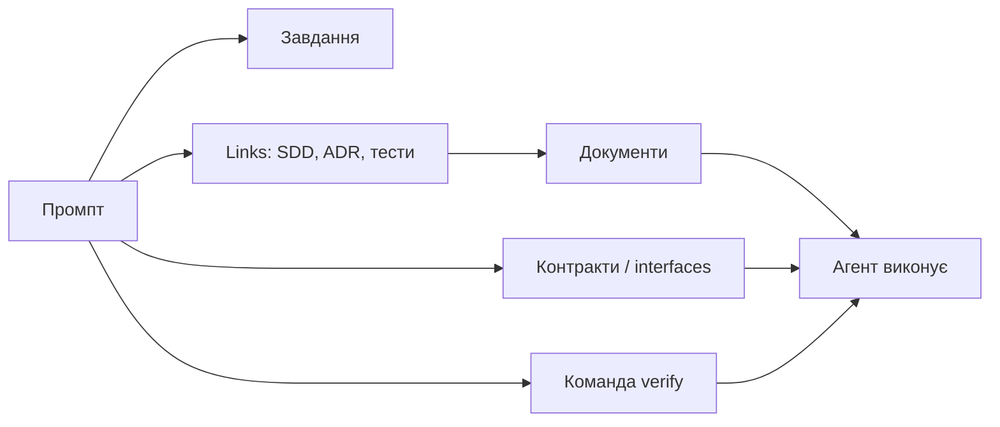

**Нотатка спікеру:**  
Приведіть приклад: у Content Agent Platform є `constitution.md`, `STATUS.md`, `RUNBOOK.md`, `kpis.md` — це symlinks. Коли я даю завдання агенту, я не кидаю 35k LOC, я кажу: «ось завдання, ось ADR, ось порт-контракт, ось команда `make gates`». І він працює.

**Пруф:**
- PaellaDoc: один головний висновок — потрібна «coordinating memory outside your head», інакше паралельна робота з агентами перетворюється на «house of cards».  
  [https://paelladoc.com/blog/factory-of-one/]
- Content Agent Platform: `interface/bootstrap.py` підʼєднує адаптери до портів; агенти не знають деталей інфри, тільки контракти.

---

### Слайд 10. Бізнес-проблема → метрика → інфраструктура

**Теза:** Спочатку розуміємо біль, потім — метрику, потім — рішення і тільки тоді інфру. Інфраструктура без бізнес-проблеми — дорогий хобі.

**Текст на слайді:**
- 1. Яка ручна операція найдорожча?
- 2. Яка метрика це вимірює?
- 3. Який slice закриє її за 1–2 тижні?
- 4. Яка інфраструктура потрібна цьому slice?

**Візуал (Mermaid):**

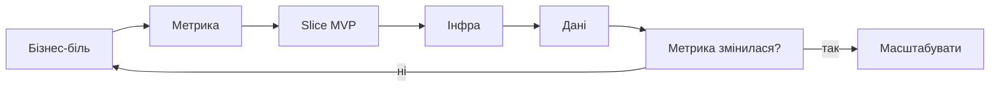

**Нотатка спікеру:**  
Приклад із RoBeauty playbook: найдорожча ручна операція — WISMO («де моє замовлення?»), 30–50% тикетів, $5–6 за контакт. Метрика: % inbound тикетів без людини. Рішення: WISMO-агент за 2–3 тижні. Інфра: n8n/LangChain + Shopify + Новая Пошта + Telegram.

**Пруф:**
- RoBeauty playbook: Impact = частота × час × вартість помилки ÷ складність автоматизації.  
  Файл: <file file="/Users/valentinyakovlev/projects/VaiYav.github.io/interviews/robeauty-head-of-it/agents.html">
- WorkOS/Anthropic: найуспішніші впровадження починали з конкретного use case, а не з технології.  
  [https://workos.com/blog/enterprise-ai-agent-playbook-what-anthropic-and-openai-reveal-about-building-production-ready-systems]

---

### Слайд 11. Нова ієрархія навичок

**Теза:** Бізнес-розуміння → процес-оркестрація → технічне виконання (LLM закриває останнє).

**Текст на слайді:**
- 1-й план: розуміти бізнес, метрики, болі
- 2-й план: вибудовувати процес, документацію, гейти
- 3-й план: глибокі технічні навички (це тепер допомагає LLM + агенти)

**Візуал (Mermaid):**

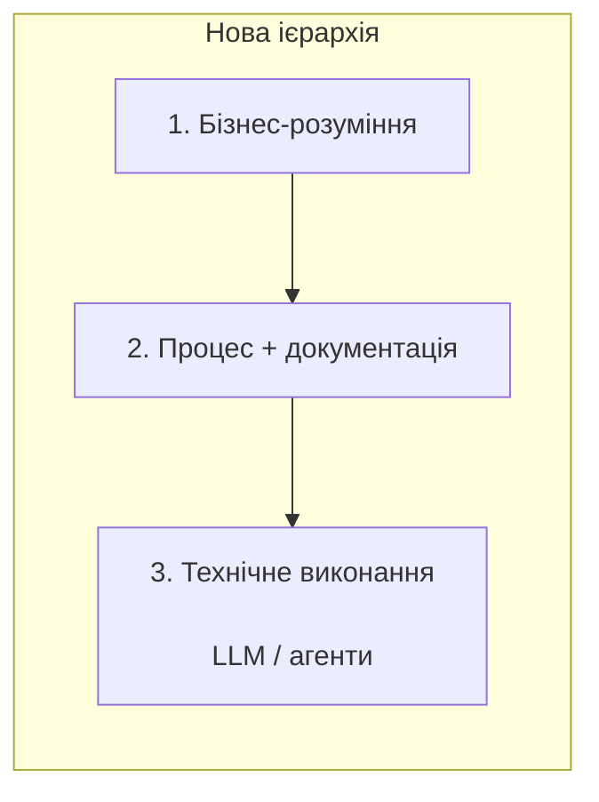

**Нотатка спікеру:**  
Це не означає, що технічні навички не потрібні. Вони потрібні, але на рівні архітектури, меж та прийняття рішень. Коли ви розумієте, як має працювати система, агент може написати 80% коду, а ви — проконтролювати 20% ключових рішень.

**Пруф:**
- 8 років full-stack досвіду дають архітектурну інтуїцію, але тепер 70% коду пишуть агенти, а людина тримає процес.
- Мій self-pitch: 70% TypeScript (Vue/Nuxt/NestJS), 20% Python (ML/data), 10% shell/configs/skills. Це вже не «програміст», а «інженер-диригент».

---

### Слайд 12. Висновок: що я продаю

**Теза:** Я не «інженер із AI-інструментами». Я — інженер, який перебудовує процес створення продукту навколо AI.

**Текст на слайді:**
- Team of One: 1 людина + N агентів = команда
- Швидкість: MVP у продакшені за 1–2 тижні
- Якість: SDD + TDD + HITL-гейти
- Масштаб: 66 мов, 1500 платних користувачів, 1700 тестів
- Підхід: бізнес → процес → агент → інфра

**Візуал (Mermaid):**

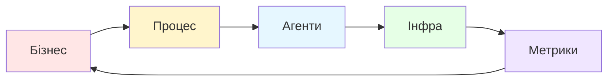

**Нотатка спікеру:**  
Завершальна фраза: «Я не кажу, що код більше не важливий. Я кажу, що час, який раніше йшов на написання 100% рядків руками, тепер йде на процес, документацію та метрики. І це дає швидкість, якої раніше було досягти неможливо.»

---

## Додаток: портфоліо-цифри

| Проєкт | Що це | Ключові цифри / доказ |
|---|---|---|
| **My Zodiac AI** | SaaS-астрологія, web + Android | 1500 платних користувачів за 4 місяці, solo; 4.5★ Play Store; 16 bounded contexts (NestJS) |
| **Soulwise AI** | Астрологічний SaaS, 100k+ користувачів | bundle 250 → 160 KB (-36%), LCP -1,2 с, conversion +8%, RAG на Qdrant |
| **Content Agent Platform** | Локалізація/генерація контенту агентами | ~35k LOC Python, ~1700 тестів, 8 агент-ролей, 18 ADR, 10 локалей |
| **QA Agent** | Автономний QA-агент | 358 Python-тестів, 67 Vitest-кейсів, LangGraph, Playwright/Schemathesis sidecar |
| **MZAI Plugins** | Набір навичок для Claude Code/Cowork | 27 плагінів, 50+ навичок, 19 sub-агентів |
| **Pitchmatch** | Маркетплейс локальних спортивних подій | NestJS + Prisma + PostgreSQL/PostGIS + Stripe Connect + BullMQ + Ionic PWA |
| **devinpipe** | Оптимізація токенів Devin | local HTTPS-проксі, PNG-конверсія великих контекстів, dashboard токен-заощаджень |
| **astro-ai-landing** | Лендінг My Zodiac AI | 66 мов, 1448 блог-статей, Nuxt 4 + Cloudflare Pages, ~50 компонентів |

---

## Джерела Exa (для підкріплення)

- PaellaDoc — Factory of one: shipping serious software as a solo founder.  
  https://paelladoc.com/blog/factory-of-one/
- First Mate — How We Shipped a Production App in Days with AI Coding Agents.  
  https://www.firstmate.tech/resources/build-mvp-in-days-with-ai-queuemate-case-study
- Agent.ceo — From 0 to Production in 1 Week with AI Agent Teams.  
  https://agent.ceo/blog/zero-to-production-one-week
- WorkOS — Enterprise AI Agent Playbook: Anthropic & OpenAI.  
  https://workos.com/blog/enterprise-ai-agent-playbook-what-anthropic-and-openai-reveal-about-building-production-ready-systems
- MongoDB — The Case Against Building Your Own Agent Platform.  
  https://www.mongodb.com/company/blog/technical/case-against-building-your-own-agent-platform
- TechCrunch — OpenAI COO: AI has not yet penetrated enterprise business processes.  
  https://techcrunch.com/2026/02/24/openai-coo-says-we-have-not-yet-really-seen-ai-penetrate-enterprise-business-processes/
- AskAntech — Async Communication for Engineering Teams.  
  https://www.askantech.com/async-communication-engineering-teams-fewer-meetings-better-code/
- Fullscale — A Tech Leader's Guide to Async Daily Standups.  
  https://fullscale.io/blog/guide-to-async-daily-standups/

---

## Питання до зали / HR

1. «Яку роль ви бачите для цієї позиції — більше продуктове мислення, архітектура чи командна оркестрація?»
2. «Який у вас зараз найдорожчий ручний процес, який ми могли б закрити агентом за 2–3 тижні?»
3. «Як у вашій команді вирішуються блокери — на мітингу чи до нього? Чи є культура async-дослідження?»
